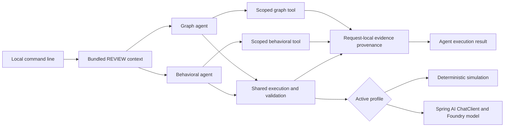

# Agent engineering

Phase 04 delivers two independent, blocking investigation agents. Invoke one agent for one bundled REVIEW case from the command line. Each invocation creates a fresh investigation, tool instance, and execution record. The original risk decision remains in the Java context and the assessment API stays independent of agent execution.

| Agent | Versioned instruction resource | Tool and source |
| --- | --- | --- |
| Graph | `prompts/graph-investigation-agent.st`, v1 | `read_graph_relationship` uses the synthetic graph provider and describes the two fictional accounts scoped to the case. |
| Behavioral | `prompts/behavioral-investigation-agent.st`, v1 | `read_behavioral_summary` joins the bundled historical activity count with the synthetic predictor's predefined label for the same transaction. |



The system prompts define objective, scope, one permitted capability, evidence handling, missing information, and the response fields. They tell the model to treat retrieved content as data and preserve the original decision. Java selects the case, authorizes the tool, validates arguments, checks evidence, and owns execution metadata.

## Run from PowerShell

Build with Java 21 and Maven 3.9.9 using `mvn clean verify`, then execute either agent independently.

```powershell
$jar = 'target/argus-fraud-intelligence-0.1.0-SNAPSHOT.jar'
java -jar $jar --spring.profiles.active=demo-local --check-investigation-agent=graph --scenario=additional-review
java -jar $jar --spring.profiles.active=demo-local --check-investigation-agent=behavioral --scenario=additional-review
java -jar $jar --spring.profiles.active=demo-local --check-investigation-agent=graph --scenario=unavailable-evidence
java -jar $jar --spring.profiles.active=demo-local --check-investigation-agent=graph --scenario=invalid-agent-response
```

The diagnostic uses the bundled expected REVIEW decision as a reproducible snapshot. It opens no HTTP listener and writes no assessment. A successful run exits with 0. An unsuccessful or unavailable run exits with 1. CLI or startup configuration errors exit with 2. JSON reports the mode, execution envelope, validation status, tool traces, candidate citations, verified references, accepted finding, and elapsed milliseconds.

For an authorized live test, configure the endpoint, deployment and short-lived Entra token as described in the [Azure integration guide](azure-integration.md). Then invoke one agent explicitly. Each command can generate up to three billable model requests.

```powershell
java -jar $jar --spring.profiles.active=demo-azure --check-investigation-agent=graph --scenario=additional-review
java -jar $jar --spring.profiles.active=demo-azure --check-investigation-agent=behavioral --scenario=additional-review
```

`demo-local` generates deterministic findings and drives the same callback and validator. The invalid-agent-response fixture rejects the graph finding while the behavioral agent can still report its own evidence. Scripted ChatModel tests exercise Spring AI's actual advisor and structured output conversion without calling Azure. `demo-azure` uses the configured model and has no simulation fallback. Live Foundry execution remains unverified.

## Conference Notes

- An ordinary model call answers a prompt. These agents can also request a scoped application capability, then use its returned evidence in the next turn.
- Agents can share a model deployment because application code selects the instruction set and tool allowlist for each run.
- Prompts describe intended behavior. Java provides the enforceable boundary through request-local tools, explicit budgets, and deterministic validation.
- The local simulation runs the callback and verification without inference. The scripted model tests additionally exercise the actual Spring AI loop. Neither path verifies a live Azure deployment.

See [Tool Calling](tool-calling.md) and [Structured Output](structured-output.md).

