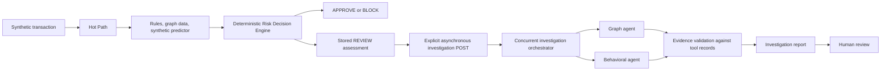

# Architecture

ARGUS is a modular monolith shipped as one Spring Boot application. Java package boundaries keep the domain independent of Spring, Spring AI, Azure, and JSON libraries. The Hot Path uses the shared domain contracts. The model connectivity and independent agent diagnostics have command-line entry points separate from the Hot Path.

## Hot Path

Assess a synthetic transaction synchronously. The deterministic Rules Engine, graph data provider, and Synthetic ML Predictor supply typed inputs to the Deterministic Risk Decision Engine. The engine emits APPROVE, REVIEW, or BLOCK with the policy version, signals, and explicit unavailable sources. Every input comes from deterministic code or source data. The Hot Path has zero dependency on an LLM or the Investigation Path. The REST adapter in `pe.jconf.argus.assessment.web` accepts only built-in scenario identifiers. The `pe.jconf.argus.assessment` package contains the policies, service, provider ports, local adapters, and volatile audit store. See the [deterministic baseline](deterministic-baseline.md) for policy semantics and responsibilities.

## Model connectivity diagnostic

The `pe.jconf.argus.ai` package selects one adapter through the active profile. The `demo-local` adapter emits a simulated result and creates no OpenAI client. The `demo-azure` adapter validates its configuration and constructs a dedicated ChatClient. Only the explicitly invoked CLI diagnostic calls the configured model. It sends a fixed acknowledgement prompt and exposes only an allowlisted response and categorized errors. The assessment and domain packages have no dependency on this adapter.

See [Azure integration](azure-integration.md) for the endpoint and authentication boundary.

## Independent investigation agents

Phase 04 packages both agents in `pe.jconf.argus.investigation`. The command line selects one agent for a bundled REVIEW snapshot. Each execution receives its own authorization scope and callback ledger. Java validates citations and supported findings before creating the existing agent execution contract. Local and Foundry adapters share the authorization and evidence validation code. See [Agent Engineering](agent-engineering.md).

## Orchestrated Investigation Path

The Investigation API accepts an existing assessment ID, checks its REVIEW decision and registers an investigation before submitting work. The orchestrator runs Graph and Behavioral concurrently against the same immutable case, with a separate scope and tool ledger per execution. Fan-in retains verified results and represents failed or missing results explicitly. The completed report includes the original risk decision and supports human review.

## Design decisions

| Decision | Reason |
| --- | --- |
| One deployable with explicit package dependencies | The demo can illustrate separation of concerns without a service network. |
| Synchronous decision followed by a separate investigation | Model latency and failure stay outside transaction assessment. |
| Application-owned outcome metadata | Investigations remain attributable when model output is invalid or unavailable. |
| Explicit availability in both paths | Policy and human reviewers can account for missing inputs without treating missing data as zero risk. |

The Investigation Path applies nested monotonic time budgets, a TimeLimiter for each agent, per-agent and deployment semaphore bulkheads, and a shared circuit breaker around model rounds. The protected operation retains its permits until it exits. See [Resilience](resilience.md) and [Containment](containment.md). Micrometer observations correlate application work with Spring AI, and Boot can export sanitized OpenTelemetry spans over OTLP. Investigation events expose a bounded trace lookup separate from the assessment and investigation records. See [Observability](observability.md) and [Distributed tracing](distributed-tracing.md). Both profiles expose the assessment API and health on loopback when running as a web application. Phase 05 implements concurrent orchestration and report aggregation in process. See [Multi-agent orchestration](multi-agent-orchestration.md) and [Investigation lifecycle](investigation-lifecycle.md).

See [Domain model](domain-model.md) for contract ownership and examples.
