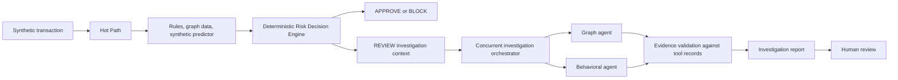

# Architecture

ARGUS is a modular monolith shipped as one Spring Boot application. Java package boundaries keep the domain independent of Spring, Spring AI, Azure, and JSON libraries. Phase 02 implements the Hot Path using the shared domain contracts and leaves the Investigation Path available as a future extension.

## Hot Path

Assess a synthetic transaction synchronously. The deterministic Rules Engine, graph data provider, and Synthetic ML Predictor supply typed inputs to the Deterministic Risk Decision Engine. The engine emits APPROVE, REVIEW, or BLOCK with the policy version, signals, and explicit unavailable sources. Every input comes from deterministic code or source data. The Hot Path has zero dependency on an LLM or the Investigation Path. The REST adapter in `pe.jconf.argus.assessment.web` accepts only built-in scenario identifiers. The `pe.jconf.argus.assessment` package contains the policies, service, provider ports, local adapters, and volatile audit store. See the [deterministic baseline](deterministic-baseline.md) for policy semantics and responsibilities.

## Investigation Path

Phase 02 exposes `investigationRequired: true` for REVIEW. A later phase will open an investigation with a snapshot of the transaction and its Hot Path decision. The orchestrator will run the Graph Investigation Agent and Behavioral Investigation Agent concurrently with bounded fan-out/fan-in. Tools will read narrowly scoped synthetic data and the application will record each tool execution. The evidence validator will resolve candidate citations against the recorded results for the current investigation and agent. The orchestrator will report each execution outcome, including timeouts and unavailable evidence.

The report supplies context to a human reviewer. The original decision remains available in the report. Agents have no financial operations or decision override capability. The dashboard will present the decision alongside the report for human review.

## Design decisions

| Decision | Reason |
| --- | --- |
| One deployable with explicit package dependencies | The demo can illustrate separation of concerns without a service network. |
| Synchronous decision followed by a separate investigation | Model latency and failure stay outside transaction assessment. |
| Application-owned outcome metadata | Investigations remain attributable when model output is invalid or unavailable. |
| Explicit availability in both paths | Policy and human reviewers can account for missing inputs without treating missing data as zero risk. |

The future resilience layer will bound latency and concurrency. Audit and observability will correlate decisions, investigation reports, and execution outcomes using Micrometer and OpenTelemetry. The existing `demo-local` profile starts offline and exposes health on loopback. The existing `demo-azure` profile supports external Foundry configuration. The Hot Path uses bundled synthetic fixtures in the running application. Investigation workflows and provider integration are future work.

See [Domain model](domain-model.md) for contract ownership and examples.
