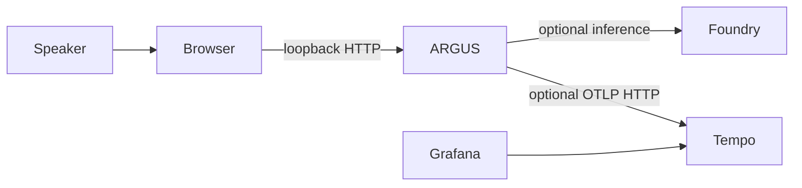
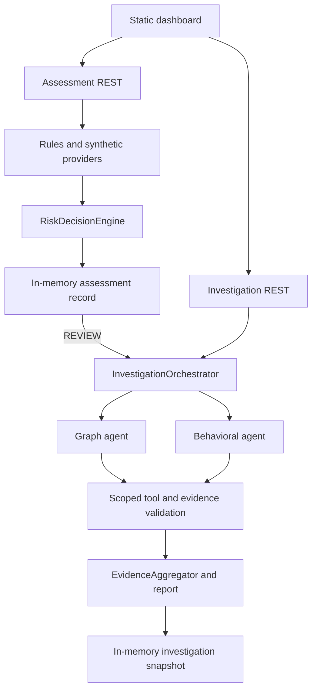
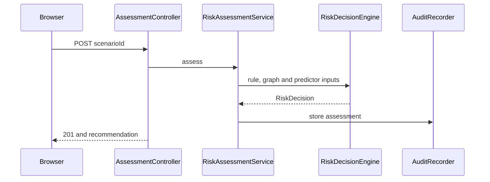
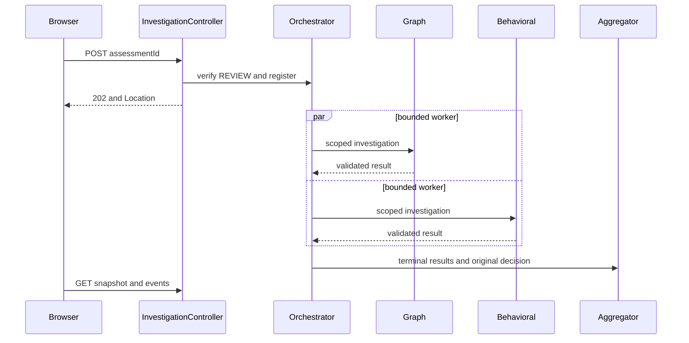
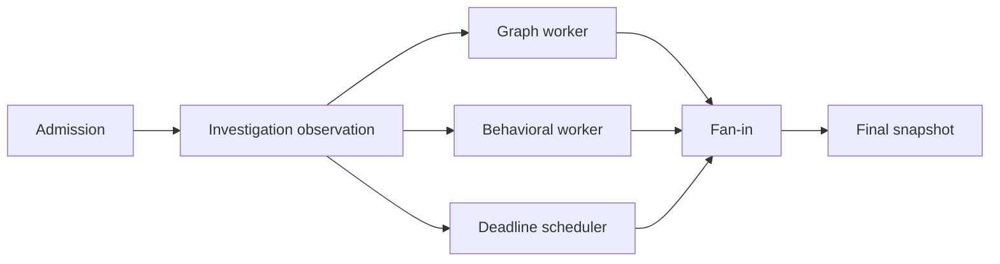
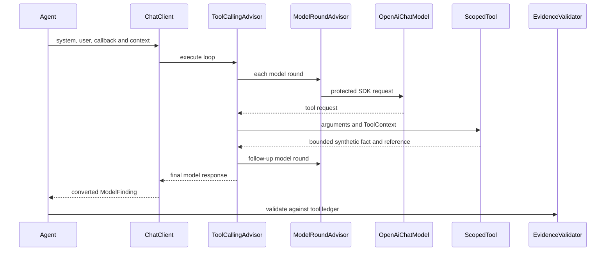
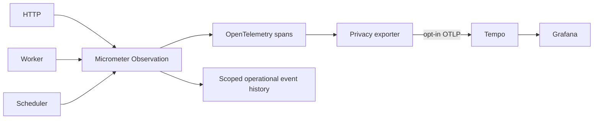

# ARGUS architecture as built

| Package | Responsibility |
|---|---|
| domain | Immutable contracts and invariants |
| assessment, assessment.web | Fixtures, providers, deterministic policy, audit recorder and REST |
| investigation | Agent selection, execution, tools, validation, concurrency, resilience and API |
| ai | Foundry settings, SDK wiring and explicit connectivity checking |
| observability | Observations, correlation, bounded events and export privacy |
| resources/static | HTML, CSS, Fetch, SVG and safe text rendering |

## Hot Path

## Investigation Path and concurrency

## Tool calling on the Azure path

Execution order per model round is deadline and round checks, agent semaphore, shared semaphore, shared circuit breaker, SDK/transport call. The coordinator TimeLimiter observes a separate stage outside the protected call. Permit lifetime follows actual execution. Four workers, a queue of four and at most two admitted cases bound local execution. Default budgets are 35 s global, 25 s agent and 10 s HTTP. See [resilience](../resilience.md).

The investigation observation is parented by submission and can link to a sampled assessment span. Explicit scopes propagate to both sibling workers and scheduled callbacks. Metrics keep bounded labels. The model can propose a callback invocation and a finding. Java owns scope, deadlines, identifiers, provenance, policy and report finalization. REST accepts references to synthetic fixtures or stored assessments; the dashboard renders strings as text. Model observations remain untrusted. The in-memory audit and operational telemetry have different purposes.

| Profile | Agent execution | Hot Path |
|---|---|---|
| demo-local | SimulatedAgentModel and scoped synthetic tools | Same deterministic policy |
| demo-azure | Spring AI and OpenAI SDK to configured Foundry deployment | Same deterministic policy |
| demo-observability | Optional overlay for OTLP | Same deterministic policy |

## Architecture comparison

| Concern | Implemented here | Simulated today | Possible Azure production component | Pending |
|---|---|---|---|---|
| Evidence | Read-only provider interfaces | Bundled graph and predictor fixtures | Approved graph storage such as Cosmos DB; Azure ML inference if justified | Adapters, data governance and validation |
| Async work | In-process bounded workers | Synthetic failure cases | Azure Service Bus for durable work if needed | Queue and idempotent consumers |
| Persistence | In-memory assessment and investigation stores | Synthetic records | Governed durable storage | Retention and access model |
| Model | Foundry adapter, Entra bearer handling and local HTTP contract tests | Local finding generation | Authorized Foundry deployment | Live inference and latency |
| Hosting | Spring Boot process | Local loopback demo | Azure Container Apps if suitable | Deployment and identity automation |
| Telemetry | Micrometer, OTel and local OTLP pipeline | Simulated workloads | Azure Monitor as a separate validated design | Grafana UI and Azure Monitor verification |

