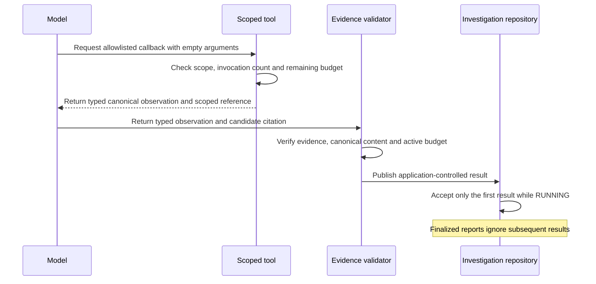

# Agent containment

ARGUS gives each agent one application-controlled callback, bound to the current synthetic investigation. A callback validates the exact Java ToolContext identity and accepts an empty JSON object. It enforces the tool invocation budget and rejects caller-supplied identifiers before invoking a fixture provider. Providers are read-only and build observations from fixed templates and typed synthetic values. Fixture references and graph account identifiers must match the expected identifier syntax. Instruction-like data in such fields is rejected before it reaches the model. A harmless test supplies synthetic metadata that asks for an unrelated tool and verifies there is no accepted evidence.

The tool advisor admits two tool requests and therefore at most three model rounds. Each model round and tool lookup checks the active monotonic deadline. The tool checks the budget again before publishing its reference. The model output converter accepts only the model-facing fields. Evidence validation compares the candidate citation and canonical observation to the exact value produced in this execution. Unauthorized arguments and fabricated citations fail deterministic checks. Prompt guidance asks the model to treat tool data as data. Java implements the access and publication controls.

When an agent hits its deadline, its gate closes and subsequent results cannot add authoritative evidence. The global gate is inherited by both agents. The accumulator preserves on-time results and produces PARTIAL or FAILED using the existing rules. An unavailable, rejected or timed-out source contributes no invented facts. The original REVIEW snapshot is retained. The Azure profile stays in Azure mode even when the circuit rejects a request.

See [Resilience](resilience.md) for the timeout hierarchy and cancellation limitations.

