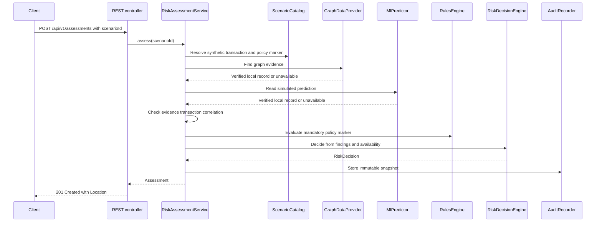

# Deterministic baseline

The Hot Path evaluates a built-in fictional transaction synchronously. It produces an educational risk recommendation and stores the assessment in process memory.

## Components

| Component | Responsibility |
| --- | --- |
| ScenarioCatalog | Read and validate the local scenario file at startup. Match provider lookups to the full synthetic transaction. |
| RulesEngine | Turn the fixture's fictional mandatory policy marker into a coded finding. |
| GraphDataProvider | Supply transaction-scoped graph evidence or explicit absence. The local adapter reads predefined graph outcomes from the scenario file. |
| MlPredictor | Supply a transaction-scoped prediction or explicit absence. The local adapter reads predefined outcomes. It simulates a predictor using fixture values. |
| RiskDecisionEngine | Apply policy precedence and produce the decision, findings, unavailable sources, and reason codes. |
| RiskAssessmentService | Resolve an allowlisted transaction, obtain and correlate provider results, evaluate the policy, and record the assessment. |
| AuditRecorder | Store and retrieve immutable assessment snapshots by application-generated UUID. |
| RiskAssessmentController | Validate scenario-only requests, return assessment snapshots, and expose the scenario catalog. |

## Policy

Policy ID `synthetic-risk` and version `synthetic-v1` identify this educational policy. Apply the first matching row.

| Priority | Condition | Decision | Reason codes |
| --- | --- | --- | --- |
| 1 | The fixture marks a fictional mandatory violation. | BLOCK | `FICTIONAL_POLICY_VIOLATION` |
| 2 | Graph evidence or the simulated prediction requires review, or a provider result is unavailable. | REVIEW | `FIXTURE_REVIEW`, `GRAPH_DATA_UNAVAILABLE`, or `SYNTHETIC_ML_UNAVAILABLE` |
| 3 | Both providers returned evidence and all inputs are clear. | APPROVE | `NO_POLICY_FINDINGS` |

The snapshot preserves all applicable findings and unavailable sources, including when the mandatory violation takes precedence. Decisions, reason codes, references, and availability are reproducible with the same fixtures and policy version. Each request receives a fresh UUID and an application-clock timestamp. The mock prediction carries a categorical outcome.

| Scenario | Decision | Reason |
| --- | --- | --- |
| `normal` | APPROVE | Both synthetic providers are available and all inputs are clear. |
| `additional-review` | REVIEW | The graph fixture requires review. |
| `mandatory-policy` | BLOCK | The mandatory policy marker is present. |
| `unavailable-evidence` | REVIEW | The graph fixture is unavailable. |
| `invalid-agent-response` | REVIEW | The simulated prediction requires review. The invalid agent payload is reserved for future investigation tests. |

## Trust boundaries and limitations

The API accepts a scenario identifier from a fixed catalog. Account identifiers, transaction amounts, input flags, evidence, and decisions come from application-owned fixtures and code. The fixture's `hotPath` fields supply inputs. Tests compare outcomes against the independently declared `expectedDecision` fields.

A verified evidence reference identifies the source and its versioned record in the bundled fixture. The adapters match the full transaction to that fixture, and the service checks evidence transaction correlation before using a result. An unavailable result has a status and reason code with no verified reference. Future Investigation Path citations will have a separate verification boundary against recorded tool results. The baseline accepts no model content or model confidence.

The audit recorder is a volatile, unbounded in-memory repository. A restart clears assessments, and separate instances have separate stores. Its records support demo replay through GET and carry no compliance or durability guarantees. The local API binds to loopback and exposes only synthetic data. This prototype implements no authentication, actual payment operation, or real fraud model.

## Conference Notes

- The baseline provides reproducible results for comparing what generative investigation adds after a case enters review.
- Deterministic logic uses typed inputs, ordinary Java, and versioned policy. Spring AI is relevant when a later investigation needs a model.
- Dependency inversion lets a future phase introduce an Azure-backed evidence adapter behind a provider interface while keeping policy tests offline.
- Explicit availability prevents a missing graph or prediction result from being treated as evidence of low risk.
- APPROVE, REVIEW, and BLOCK are recommendations over fictional fixtures. The assessment writes a demo record and has no connection to payment or account systems.

See the [API guide](api.md) for reproducible local requests.

