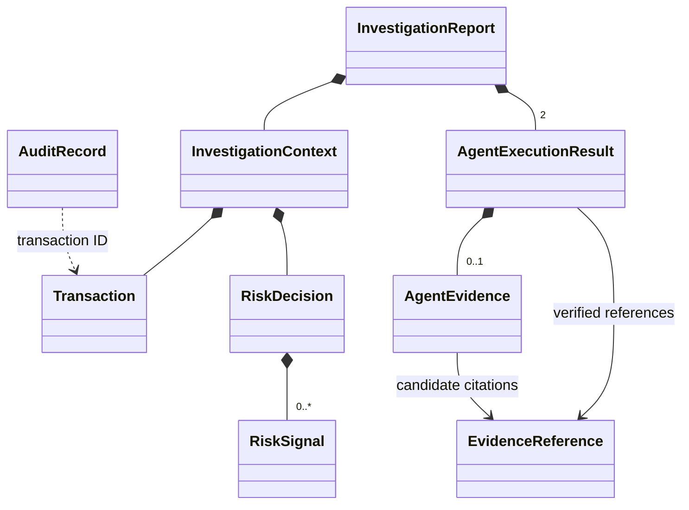

# Domain model

The contracts in `pe.jconf.argus.domain` use Java records, enums, and JDK types. Internal identifiers use UUID values while synthetic transaction and source record identifiers use strings. The application will allocate investigation, audit, agent execution, and tool execution IDs and record authoritative timestamps. The synthetic fixtures use fixed identifiers and times for reproducibility.

| Contract | Responsibility |
| --- | --- |
| Transaction | Carries transaction and account identifiers, a positive BigDecimal amount, an ISO currency identifier, and an Instant. Decimal precision and scale are preserved. |
| RiskSignal | Represents a coded finding from the rules, graph data, or synthetic predictor. |
| RiskDecision | Captures a policy-versioned Hot Path outcome, its signals, and any unavailable sources. |
| InvestigationContext | Couples the case ID with the reviewed transaction, its original REVIEW decision, and the opening time. |
| EvidenceReference | Identifies a tool execution, the source record it returned, and the evidence type. |
| AgentEvidence | Carries a model observation, self-reported confidence, and candidate citations. |
| AgentExecutionResult | Carries application-owned identity, outcome, timing, verified references, and optional accepted model evidence. |
| InvestigationReport | Captures a correlated outcome for every expected agent together with the original REVIEW context. |
| AuditRecord | Correlates a decision or report event to a synthetic transaction and a recording time. |



## Trust boundaries

The model-facing schema is `AgentEvidence`. Its citations are claims of provenance. In a later phase, the evidence validator will match each candidate reference to a tool invocation recorded for that agent and investigation, confirm that the referenced record and its type occur in the tool result, and check that the observation is supported. The execution record accepts SUCCESS only when there is evidence with at least one citation and all citations are in the application-supplied verified set. Constructors enforce structural consistency. The application owns provenance verification and creates the trusted execution envelope.

Self-reported confidence is a decimal in [0, 1] for the observation. It has no calibrated probability interpretation and does not enter the Hot Path. An unsuccessful execution carries its explicit status with no accepted evidence. The report requires one result per agent, including explicit UNAVAILABLE results for missing evidence. In the Hot Path, unavailable sources are carried separately from findings and must be considered by deterministic policy.

## Example JSON

Hot Path decision for a transaction with unavailable graph input.

```json
{
  "transactionId": "SYN-TXN-004",
  "decision": "REVIEW",
  "policyVersion": "synthetic-v1",
  "decidedAt": "2026-11-26T14:00:01Z",
  "signals": [],
  "unavailableSources": ["GRAPH_DATA"]
}
```

Investigation execution result for a synthetic graph observation. The repeated reference represents the model citation and its independently verified source.

```json
{
  "executionId": "00000000-0000-4000-8000-000000000002",
  "investigationId": "00000000-0000-4000-8000-000000000001",
  "agent": "GRAPH",
  "status": "SUCCESS",
  "startedAt": "2026-11-26T14:00:02Z",
  "finishedAt": "2026-11-26T14:00:03Z",
  "evidence": {
    "observation": "The graph fixture contains a shared synthetic counterparty.",
    "confidence": 0.70,
    "citedReferences": [{
      "toolExecutionId": "00000000-0000-4000-8000-000000000003",
      "recordId": "SYN-GRAPH-1",
      "type": "GRAPH"
    }]
  },
  "verifiedReferences": [{
    "toolExecutionId": "00000000-0000-4000-8000-000000000003",
    "recordId": "SYN-GRAPH-1",
    "type": "GRAPH"
  }]
}
```

For `UNAVAILABLE` or `INVALID_RESPONSE`, use `"evidence": null` and `"verifiedReferences": []`. See the [synthetic fixture data](../src/main/resources/synthetic/scenarios.json) for transaction envelopes and five expected scenario outcomes.
