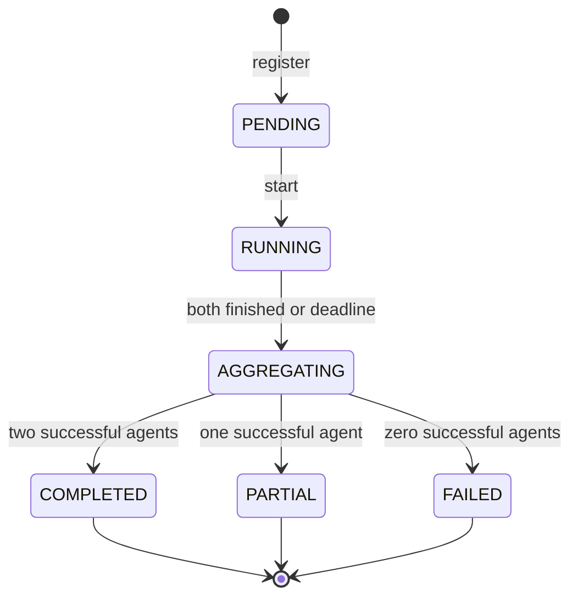

# Investigation lifecycle

A process-local repository indexes investigations by investigation ID and by the stored assessment ID. A request authorizes the case using an existing synthetic REVIEW assessment. All IDs and timestamps are generated by Java. The repository retains the original risk decision, current status, agent results, verified references, event metadata and completed report.

The initial POST returns the registered PENDING snapshot. Polling may first observe RUNNING, AGGREGATING, or a terminal status. The repository guards transitions under one monitor and returns immutable collection snapshots. Agent states are represented through AGENT_STARTED events and final execution statuses. A timeout, tool unavailability, invalid structured response, or worker exception occupies one explicit result slot. Terminal status counts successful agents and does not change the assessment decision. Agent results use stable source order regardless of completion order.

One investigation is allowed per assessment for the process lifetime. A repeated POST returns the same investigation with 202 while active or 200 when terminal. Repetition never reruns a failed or partial investigation. To create a fresh test case, create a new synthetic assessment. New requests receive 429 if both admission slots are occupied. Existing investigations can still be polled at capacity.

## Events

Every record exposes lifecycle events for later presentation. Events contain the investigation ID, event type, optional agent and execution IDs, optional agent status, current lifecycle status, and timestamp. Event types are INVESTIGATION_CREATED, INVESTIGATION_STARTED, AGENT_STARTED, AGENT_COMPLETED, AGENT_FAILED, EVIDENCE_AGGREGATED, and INVESTIGATION_COMPLETED. Publication order reflects what the repository observed. The report orders results separately. Events carry no prompts, raw errors, or credentials.

The repository and assessment audit are volatile and process-local. Restarting the process clears IDs, reports, events and deduplication keys. History grows with the number of cases and has no eviction, persistence, or compliance guarantees. The demo binds to loopback and uses fixtures exclusively.

