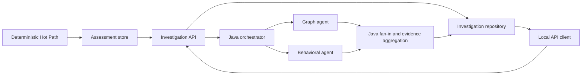
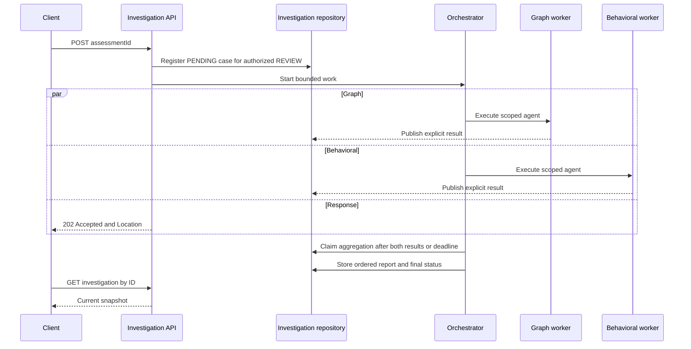

# Concurrent multi-agent orchestration

The Investigation Path starts when the caller posts an existing assessment ID. ARGUS retrieves the application-owned assessment, requires REVIEW, and creates an immutable context containing the original RiskDecision. The Hot Path continues to evaluate synthetic transactions independently. Each agent uses its own prompt, tool scope, and verified evidence ledger.

## Fan-out and fan-in

The orchestrator registers the investigation, transitions to RUNNING, and submits both blocking agents to a dedicated executor using `CompletableFuture.runAsync`. Each worker publishes its result independently. `allOf` triggers normal fan-in after both tasks finish. A managed timer can trigger fan-in first by marking unresolved slots TIMEOUT. The repository atomically claims aggregation and rejects late results. This preserves evidence that arrived on time.

The aggregation orders results by AgentType and deduplicates the verified reference list by execution ID, record ID and evidence type. The report retains each source agent and its accepted observation, along with the original risk decision and failed or unavailable slots. A verified reference establishes application-checked provenance. The accompanying observation remains an evidence-backed investigation finding. Confidence remains model self-report. Human reviewers receive evidence and execution status.

## Execution limits

- Each application process owns four named platform workers, a worker queue of four slots, and one deadline thread. Admission is limited to two investigations with outstanding work and at most two queued deadline entries. Blocking work does not use the common ForkJoinPool.
- A 35-second investigation deadline bounds waiting for the report. The existing Spring AI transport timeout and tool budget remain in effect. Timed-out tasks retain their admission slot until the underlying workers exit. The deadline freezes the report while model calls may still finish remotely.
- Shutdown closes admission, finalizes unfinished slots with ERROR, shuts down both executors, interrupts workers on a best-effort basis, and waits up to two seconds for each executor. Remote HTTP cancellation is not guaranteed.
- `demo-local` supports the invalid and unavailable fixtures, and `--argus.investigation.simulated-failure=GRAPH` or `BEHAVIORAL` triggers a deterministic worker error in orchestrated investigations. `demo-azure` uses the configured Foundry agents. Only an explicitly submitted investigation triggers inference. Automated tests use offline fixtures and deterministic doubles.

## Conference Notes

- Graph and Behavioral retrieve independent evidence, so fan-out avoids waiting for one before starting the other.
- Deterministic Java enforces admission, time limits, state transitions, and evidence aggregation. Spring AI handles each agent's model calls, tool loop, and response conversion.
- The agents can share a deployment because each execution supplies its own prompt and tool permissions. The deployment quota is shared.
- Partial reports preserve timely verified evidence and make unavailable or invalid evidence visible to human reviewers.
- An asynchronous API lets the client retrieve status while the application runs blocking agent calls.
- A modular monolith keeps both agents in one deployable while preserving explicit code and trust boundaries. The agents require no additional services to coordinate.

See [Investigation lifecycle](investigation-lifecycle.md) and [API](api.md).

