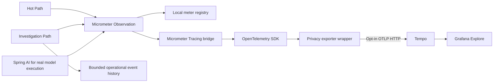

# Observability

Phase 07 uses the Spring Boot Actuator ObservationRegistry and metrics registry. Boot connects Micrometer Tracing to one OpenTelemetry SDK. The dedicated `demo-observability` profile enables OTLP/HTTP trace export and local Actuator metrics. The execution profiles remain independent of exporters and of each other.

## Metrics catalog

Timers expose duration and count. Application labels are fixed enums or bounded application values. Measurements are local to the application process.

| Meter | Meaning | Application labels |
| --- | --- | --- |
| `argus.assessment` | Assessment duration and outcome | status |
| `argus.assessment.decision` | Deterministic decision evaluation | status |
| `argus.investigation.create` | Submission, lookup and admission | mode |
| `argus.investigation` | Admission through final report | mode, status |
| `argus.agent` | Actual agent worker duration | agent, mode, status, late, token.usage |
| `argus.agent.outcomes` | Accepted authoritative agent result | agent, mode, status |
| `argus.evidence.validation` | Deterministic validation work | agent, mode |
| `argus.evidence.aggregation` | Fan-in evidence aggregation | mode |
| `argus.investigation.completion` | Final report publication and outcome | mode, status |
| `argus.investigation.fallback` | Capture of a controlled degradation result | outcome |
| `argus.tool.executions` | Simulated tool invocations | agent, mode, status |
| `argus.resilience.events` | Count of classified timeout, validation, fallback, circuit, bulkhead and late-result signals | event |

Spring AI 2.0.1 supplies `spring.ai.chat.client`, `gen_ai.client.operation`, `spring.ai.advisor`, `spring.ai.tool` and `gen_ai.client.token.usage`. The timer counts for model and tool operations provide real invocation counts when those operations run. ARGUS supplies the shared registry to the manually constructed ChatClient, OpenAiChatModel and tool manager. Simulated agents generate neither model calls nor token samples. The application marks simulated token usage as `unavailable`. Model observations carry `token.usage=available` or `unavailable` based on whether provider usage metadata exists. The default SDK HTTP client does not add another client span.

## Events and privacy

`GET /api/v1/investigations/{id}/events` returns sanitized operational events for that case. The process retains at most 512 events across all cases and evicts the oldest first. A known case may return an empty list after eviction. Trace and span IDs are present when an active tracing context exists. A trace ID outside sampled mode may have no recorded trace. Shared circuit transitions contribute to metrics even when no case owns the event.

Prompt, completion, tool content and raw model error logging are disabled. The observation filter drops high-cardinality attributes and removes provider response model from meter tags. Exported spans retain an allowlist of bounded attributes and the ARGUS service name. The exporter strips span events, status descriptions, link attributes and trace-state values. It preserves IDs, span relationships, timing, kind and status code. The assessment span link keeps only the linked trace and span context. The operational event history retains sanitized lifecycle and resilience categories separately. Transaction IDs, account IDs, investigation IDs and error messages are excluded from metric labels. The assessment repository remains the business record for the synthetic demo.

## Conference Notes

- Metrics answer how often and how slowly. Events show what the application decided to record. Traces show how related work ran and where it spent time.
- Micrometer instruments application operations and metrics. Its tracing bridge sends observation spans to the OpenTelemetry SDK and exporter.
- A span measures one operation. Parallel agent spans share a parent and overlap on a waterfall.
- Spring AI supplies observations for its real model and tool operations. A simulated agent remains visible as an application span.
- Operational telemetry is a diagnostic record with retention and sampling limits. The synthetic assessment repository has a separate purpose.

## Optional Azure Monitor approach

Proposed and unverified. Microsoft documents Application Insights Java 3.x agent instrumentation for Java applications. Use an authorized Application Insights resource and supply `APPLICATIONINSIGHTS_CONNECTION_STRING` from a protected runtime environment. Run a separate configuration with the supported agent and disable Boot's SDK and exporter using `management.opentelemetry.enabled=false` and `management.tracing.export.enabled=false`. Recheck HTTP instrumentation, privacy and metric capture before enabling cloud export. The agent can instrument supported frameworks. ARGUS's Micrometer Observation spans and Spring AI custom observations must be verified individually in that setup. A future integration can add supported manual OpenTelemetry instrumentation against the agent's global API if those spans are absent. The Java agent does not pass through the ARGUS exporter wrapper, so equivalent sanitization is a prerequisite. This proposal uses Microsoft's Java instrumentation path and does not treat Azure Monitor as an arbitrary OTLP receiver.

## References

- [Spring AI observability](https://docs.spring.io/spring-ai/reference/2.0/observability/index.html)
- [Spring Boot observability](https://docs.spring.io/spring-boot/reference/actuator/observability.html)
- [Spring Boot tracing](https://docs.spring.io/spring-boot/reference/actuator/tracing.html)
- [Azure Monitor OpenTelemetry setup](https://learn.microsoft.com/en-us/azure/azure-monitor/app/opentelemetry-enable)
- [Azure Monitor instrumentation configuration](https://learn.microsoft.com/en-us/azure/azure-monitor/app/opentelemetry-add-modify)

