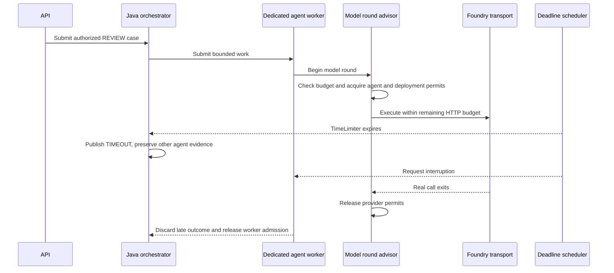
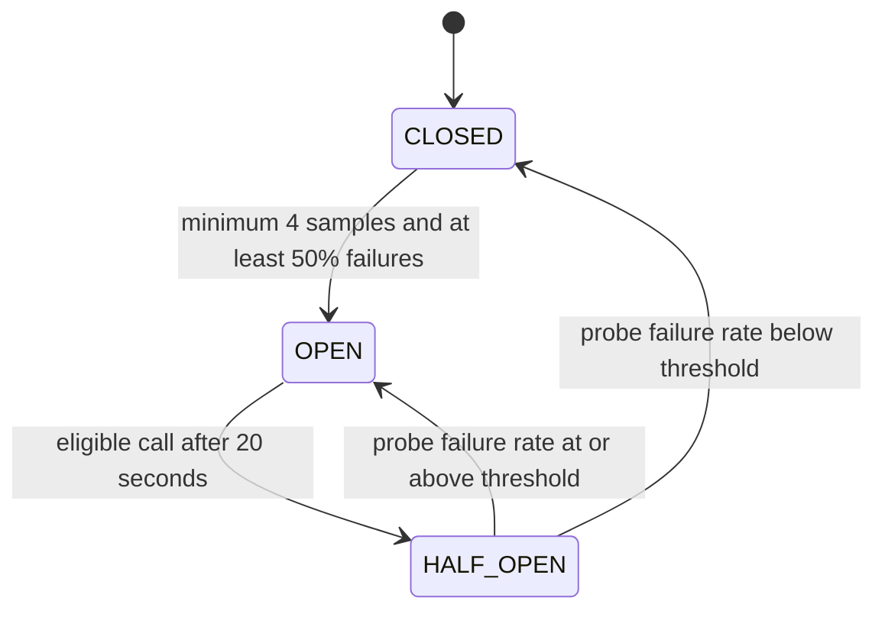

# Investigation resilience

Phase 06 preserves the offline Hot Path and contains the blocking Investigation Path. Both Foundry agents use one deployment-wide circuit breaker. Each model round is protected independently. Local simulation bypasses the remote dependency, while offline tests exercise the same protection with scripted failures and a controlled clock.

## Timeout hierarchy

| Boundary | Property | Demo default |
| --- | --- | --- |
| Global investigation | `argus.investigation.deadline` | `PT35S` |
| Agent execution from submission | `argus.investigation.agent-timeout` | `PT25S` |
| Individual HTTP request | `argus.investigation.http-request-timeout` | `PT10S` |

The configuration requires 1 ms ≤ HTTP timeout ≤ agent budget ≤ investigation deadline. The Azure SDK transport timeout also uses `spring.ai.openai.timeout`, mapped to the HTTP budget by default. These are teaching settings. Queue time, tool calls and repeated model rounds consume the agent and investigation budgets. ARGUS uses a monotonic clock for elapsed budgets. Before each model round, the advisor sets its HTTP timeout to the lesser of the configured maximum and the remaining agent and investigation budgets. New operations require a positive budget. At the global deadline the repository closes unresolved result slots and runs bounded in-memory aggregation.

A REST client can stop waiting for its HTTP response or choose to stop polling. Neither action changes the investigation. An agent TimeLimiter applies to a separate completion stage, which allows fan-in to publish without waiting for the real worker. A transport timeout bounds the SDK request on the client. The orchestrator requests a worker interrupt when an agent or global timer expires. The provider may already have accepted the request, so neither interruption nor a completed timeout future proves remote cancellation. Worker admission and provider permits stay occupied until the actual operation exits.

## Decorator ordering

| Order | Layer | Purpose |
| --- | --- | --- |
| 1 | Monotonic deadline gate | Reject new work when the agent or investigation has expired. |
| 2 | Agent-type semaphore bulkhead | One concurrent model call per agent type. Graph saturation leaves capacity for Behavioral and vice versa. |
| 3 | Deployment semaphore bulkhead | Two concurrent calls across the shared deployment. Admission is fail-fast. |
| 4 | Shared circuit breaker | Screen remote calls and sample only eligible remote failures. |
| 5 | Actual model round with dynamic HTTP timeout | Apply the remaining budget in Spring AI and the SDK transport. |

Thread isolation comes from the existing four dedicated workers, queue of four and admission of at most two investigations. Semaphore isolation caps use of the remote dependency on those same workers. It adds no executor or queue. One scheduler owns the global and per-agent timers, with at most three outstanding timers per admitted case. TimeLimiter observes a separate agent stage outside the actual call, so timing out that view cannot release the protected operation's permits. Saturation and circuit rejection produce an explicit unavailable agent result; executor rejection is recorded as an error when a worker slot cannot be submitted.

## Shared circuit breaker

The count window is four calls, with a minimum of four and a 50 percent failure threshold. The circuit stays OPEN for 20 seconds. The next eligible call advances it to HALF_OPEN. Two probes determine the next state. Bulkhead rejections, deadline gate rejections and invalid output do not add failure samples.

| Failure | Classification | Counts towards circuit |
| --- | --- | --- |
| HTTP 408 and 5xx | Transient provider | Yes |
| HTTP 429 | Rate limit | Yes |
| Network failure or HTTP transport timeout | Network or HTTP timeout | Yes |
| HTTP 401 or 403 | Authentication | No |
| Other provider HTTP errors, including deployment 404 | Configuration or rejected request | No |
| Invalid structured output | Evidence validation failure | No
| Invalid tool arguments or scope | Tool rejection | No
| Local processing error | Application failure | No |
| Circuit open, local saturation, or exhausted operation budget | Admission or containment | No |

## Retry policy and signals

ARGUS has no application retry. The existing OpenAI Java SDK configuration fixes `spring.ai.openai.max-retries=0`. Spring AI 2.0.1's OpenAI chat model calls the SDK directly. Its OkHttp transport still enables connection recovery within an individual request. Model turns following tools are subsequent protocol steps. Transport recovery or manually resubmitting a new assessment can consume additional requests or tokens. Credential and validation errors are never retried by ARGUS.

Spring application events describe timeouts, circuit transitions and rejections, bulkhead rejection, classified remote failure, fallback, late-result discard, tool rejection, evidence validation failure, and global deadline exceeded. Events use application IDs, agent type and bounded outcome labels. Late events stay outside the immutable investigation response and provide hooks for Micrometer or future tracing. Raw prompt, credential and provider error data stays out of these events.

## Conference Notes

- A timeout ends a waiting contract. The execution can continue and still owns its resource permits.
- A circuit breaker answers whether the dependency is likely healthy. A bulkhead answers whether a caller has capacity now.
- Shared model hosting creates a shared failure domain even when the agents use different prompts.
- Missing evidence leaves uncertainty visible. A verified partial result still supports human review.
- Freezing the final report preserves what the reviewer could see at completion.

## References

- [Resilience4j 2.4.0 release](https://github.com/resilience4j/resilience4j/releases/tag/v2.4.0)
- [Resilience4j getting started](https://resilience4j.readme.io/docs/getting-started)
- [Azure Circuit Breaker pattern](https://learn.microsoft.com/en-us/azure/architecture/patterns/circuit-breaker)
- [Azure Bulkhead pattern](https://learn.microsoft.com/en-us/azure/architecture/patterns/bulkhead)
- [Azure transient fault guidance](https://learn.microsoft.com/en-us/azure/architecture/best-practices/transient-faults)

