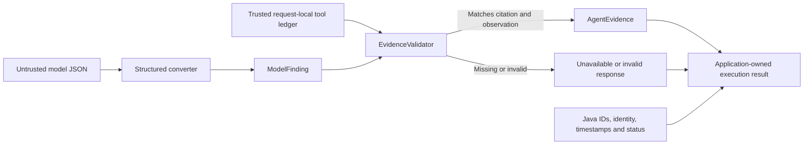

# Structured output and evidence

The blocking Spring AI path calls `.call().entity(converter)` using a `BeanOutputConverter<ModelFinding>`. This converts the final text using a Java-record schema added to the prompt. This path works with the tool advisor without enabling provider-native JSON schema mode. Provider support for combined native structured outputs and tools varies by deployment. Schema retry advisors are absent so invalid output has a bounded failure path.

```json
{
  "observation": "The graph fixture links synthetic accounts SYN-ACCOUNT-A2 and SYN-ACCOUNT-B2 for this case.",
  "confidence": 1,
  "citedReferences": [{
    "toolExecutionId": "00000000-0000-4000-8000-000000000003",
    "recordId": "synthetic-fixtures-v1/additional-review/graph",
    "type": "GRAPH"
  }]
}
```

The UUID here is illustrative. Java creates each tool execution ID when it returns a result. Jackson decodes the model-only DTO, rejecting unexpected fields and trailing content. `EvidenceValidator` checks the confidence range and requires a single citation whose execution ID, record ID, and evidence type match the result returned by the current callback. It compares the proposed observation to the exact deterministic observation attached to that result. This intentionally narrow demonstration accepts canonical observations and rejects free-form conclusions, even when a citation is genuine.

An unavailable result can be reported using the fixed missing-evidence observation, zero self-reported confidence, and an empty citation array. This is accepted only if the tool actually reported absence. The execution then has status UNAVAILABLE with no accepted evidence. Missing evidence is absence of a result, with no calibrated probability implied.



Candidates shown in the diagnostic are untrusted and record IDs outside the expected fixture format are redacted. Findings in the result come from the canonical tool observation after validation. The application generates agent type, investigation and execution IDs, status, timestamps, and accepted evidence references. The diagnostic publishes no raw model output or provider errors.

## Conference Notes

- Structured Output establishes parseable shape. Semantic validation verifies the relationship between the typed claim and the actual evidence.
- A valid UUID or a real fixture record ID alone proves nothing. The application must have returned that exact tuple from a tool in the current run.
- A model's confidence describes its own response. It is not a calibrated fraud probability or a transaction decision.

References: [ChatClient API](https://docs.spring.io/spring-ai/reference/2.0/api/chatclient.html), [Structured Output](https://docs.spring.io/spring-ai/reference/2.0/api/structured-output.html), [Spring AI v2.0.1 source](https://github.com/spring-projects/spring-ai/tree/v2.0.1).

