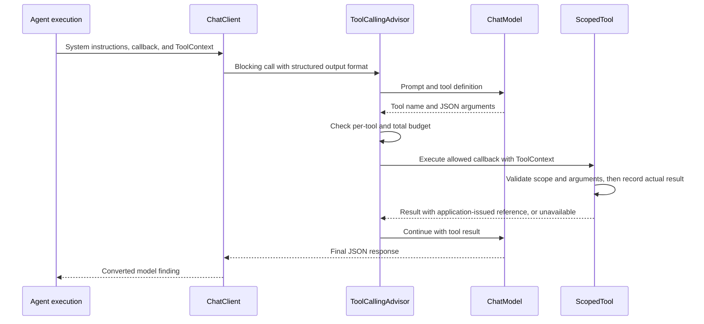

# Tool Calling

ARGUS uses explicit Spring AI 2.0.1 `ToolCallback` registration via `.toolCallbacks(...)`. Each callback advertises a `ToolDefinition` with an empty-object JSON schema, receives input and `ToolContext`, and returns a JSON tool result. Spring AI's `@Tool` offers a method-level alternative that derives callback definitions from Java signatures and descriptions. The explicit callback here validates the raw arguments and authorized context before invoking any provider.

## Scope and budget

The model receives only the selected tool definition and may supply only `{}`. `ToolContext` holds the Java-owned callback identity. The callback compares object identity before it runs a provider. A second investigation of the same transaction gets a different callback identity. Tool arguments are parsed as JSON and rejected before any lookup if they supply an identifier or any other fields. Both providers read bundled data, and each callback checks that the provider result belongs to the current transaction.

In the exact 2.0.1 source, `DefaultChatClient` registers a `ToolCallingAdvisor` only when the request has no existing `ToolAdvisor`. The adapter attaches one configured advisor with a `DefaultToolCallingManager`. The manager disables fallback name resolution and allows two requests per tool and two total within a turn. With the THROW behavior, the advisor terminates the loop on the first excess request before invoking the callback. The per-run callback also enforces two submissions for direct callers, including the simulation. Rejected tool inputs consume budget.

A scripted model requests a third call to verify that exactly two provider lookups occur and the model receives no fourth turn. The configured SDK timeout applies per HTTP request. The demo relies on this timeout and the bounded tool loop. It does not impose a separate end-to-end deadline or provide cancellation of remotely accepted inference. Budget breaches yield a rejected structured response.

## Conference Notes

- `@Tool` exposes a Java method as a model-callable tool when registered. A `ToolCallback` expresses the same contract explicitly and can guard the raw JSON.
- `ToolCallingAdvisor` drives the turn across model responses and Java callbacks. The model requests execution and Java enforces what runs.
- `ToolContext` carries application-owned values for callbacks. The empty argument schema keeps investigation and account identifiers out of model-controlled input.

References: [Tool Calling](https://docs.spring.io/spring-ai/reference/2.0/api/tools.html), [ToolCallingAdvisor](https://docs.spring.io/spring-ai/reference/2.0/api/tools/tool-calling-advisor.html), [Spring AI v2.0.1 source](https://github.com/spring-projects/spring-ai/tree/v2.0.1).

